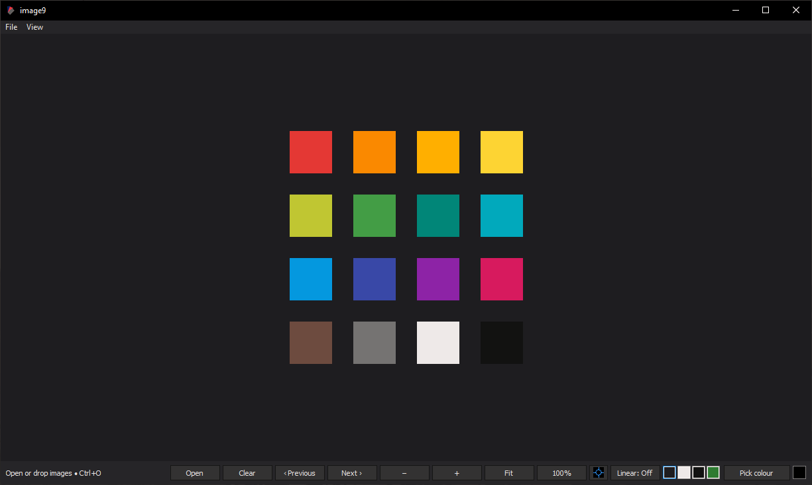

<h3>image9</h3>
<small>Spatial image viewer - <a href="https://github.com/hazzard993/image9/releases/latest/download/image9.exe">Download</a></small>
 
 

Suitable for:

- Viewing large images
- Viewing multiple images at once (drop images into viewer)

Features:

- Quick image viewing (fast to open, q to exit)
- Zooming and panning through images
- Keyboard friendly navigation

Modes:

- Use ctrl to switch to inspect mode (use I to lock it, esc to exit)

Controls:

- LMB or MMB - Panning the viewer
- RMB - Toggle colour picker
- Ctrl+RMB - Remove an image from workspace
- 1, 2, 3, 4 - Change background colour
- Shortcuts should be listed under "View"
